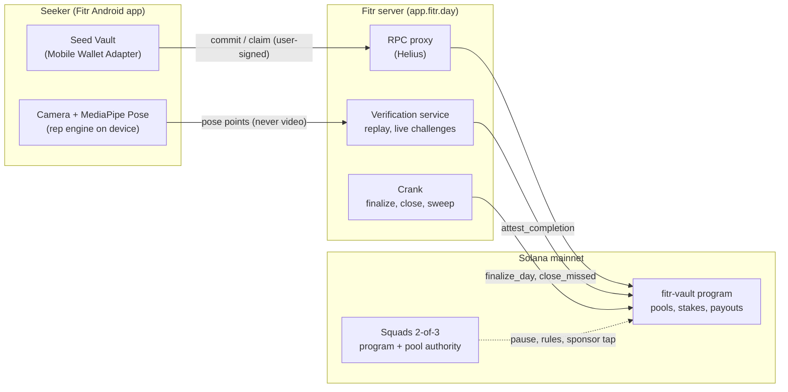

<div align="center">

# Fitr

**Put your word on the line.**

A fitness commitment app for the Solana Seeker: stake your own SKR on a daily workout goal,
let on-device AI count every rep, and settle the day onchain.

[](https://explorer.solana.com/address/9eYqN31joVSrEvtXKNYJRNdbP7m4LbdGfFd9n4BmgikY)
[](https://fitr.day/download/fitr.apk)
[](https://solanamobile.com)
[](#testing)
[](#features)
[](./LICENSE)

[Website](https://fitr.day) · [Download the APK](https://fitr.day/download/fitr.apk) · [Live pool](https://fitr.day/pool) · [Architecture](./docs/ARCHITECTURE.md) · [Security](./docs/SECURITY.md) · [Vision](./docs/VISION.md)

<!-- Demo video: add the link here once published, e.g. · [Demo video](https://...) -->

<sub>Built for the CLOCK IN Solana Mobile hackathon.</sub>

</div>


## What is Fitr?

Fitr turns "I'll work out tomorrow" into a promise with something on it. You pick a daily goal
(one of 16 exercises), stake the amount of SKR you choose and show up. The AI on your phone counts
every rep against a joint-angle standard; Fitr's verification server re-checks the session,
including random live challenges, and marks the day complete onchain. Hit the goal and your stake
comes back plus a share of what the no-shows forfeited. Miss it and your stake goes to the people
who showed up.

It is a **commitment device, not an investment**: if everyone shows up, everyone simply gets their
own stake back. Fitr's only fee is 5% of forfeited stakes. Video never leaves the phone.

**Contents:** [Try it](#try-it) · [The problem](#the-problem-and-how-fitr-solves-it) ·
[Features](#features) · [How it works](#how-it-works) · [Solana Mobile](#built-for-solana-mobile) ·
[Mainnet](#live-on-solana-mainnet) · [Security](#security-at-a-glance) ·
[Getting started](#getting-started) · [Roadmap](#roadmap)

## Try it

1. **Install.** On a Seeker, download [the APK](https://fitr.day/download/fitr.apk) and install it.
2. **Work out.** Open **Workouts**, pick an exercise and do a set. Rep counting needs no wallet
   and no account.
3. **Commit.** In **Commit**, connect Seed Vault, choose a goal and stake SKR before 18:00 UTC.
   Do the workout that day; the app verifies it and records it onchain.
4. **Claim.** After the day settles (from 02:00 UTC), tap **Claim** for your stake plus your share.

Every stake, verification and payout is public: see the [live pool](https://fitr.day/pool) or the
program on [Solana Explorer](https://explorer.solana.com/address/9eYqN31joVSrEvtXKNYJRNdbP7m4LbdGfFd9n4BmgikY).

## The problem, and how Fitr solves it

| The problem | The evidence | How Fitr solves it |
| --- | --- | --- |
| **We pay, then don't show up.** | Gym members on flat monthly plans averaged 4.3 visits a month, paying over $17 a visit when a $10 pass was on offer (DellaVigna & Malmendier, *American Economic Review*, 2006). | Your own SKR goes on today's goal. Show up and it comes back; skip it and it is gone. |
| **Nobody checks the reps.** | In a self-reported log, a half-rep or yesterday's video counts the same as the real thing. | On-device pose AI holds every rep to a standard; the server replays the session and issues live challenges a pre-recorded clip cannot answer. |
| **Skipping costs nothing.** | Losses weigh about twice as much as gains (Tversky & Kahneman, 1992); commitment contracts with money at stake help people keep promises (Giné, Karlan & Zinman, *AEJ: Applied*, 2010). | Every day settles onchain by rules nobody can bend, and crews add friends who see whether you showed up. |

## Features

- **AI rep counting, on the phone.** 16 bodyweight exercises (push-ups to burpees) tracked with
  MediaPipe Pose; each rep is judged by joint angles, half-reps do not count. Form guides, a
  3-2-1 countdown, a live HUD and a voice coach.
- **Stake on yourself.** 1 to 10,000 SKR on a goal you choose, locked onchain in one transaction
  signed in Seed Vault. Claim your stake plus your share the next morning.
- **Cheat-resistant verification.** The server replays the pose trace (never video), checks
  tracking quality and random live challenges ("Raise one hand above your head"), then attests
  onchain.
- **Crews.** Commit with friends in your own onchain pool: invite links, a crew streak, a
  leaderboard, and forfeits that roll over to the next day someone completes.
- **Sponsored days.** Brands, gyms or anyone can add a bonus for the people who finish, from the
  app or a Blink. Nobody can withdraw the reserve; it only pays finishers.
- **Blinks and share cards.** "Commit with me" and "Sponsor a day" Solana Actions, and a share card
  for every verified day.
- **A real Android app.** Native camera, text-to-speech coach, daily reminders, a home-screen
  widget, app shortcuts and verified App Links, with minimal permissions.
- **9 languages.** English, 简体中文, 日本語, 한국어, Italiano, Español, Français, Português and
  Deutsch, including the voice coach.
- **Progress.** Streaks, a streak calendar, personal records, awards and a history that shows
  what happened to every stake.

## How it works



**A day, end to end** (UTC):

| When | What happens |
| --- | --- |
| 00:00 to 18:00 | **Commit.** Choose exercise, goal and stake in one transaction (it also claims yesterday's payout). Commits after 18:00 count for the next day. |
| until 24:00 | **Work out.** The phone counts reps; the server verifies the session and marks the day complete onchain. |
| 00:00 to 01:00 | **Grace hour.** Verifications still in flight can land. |
| 01:00 to 02:00 | **Review window.** The multisig can void a bad day, refunding everyone. |
| from 02:00 | **Settle.** The crank finalizes the day and marks no-shows missed. Finishers tap **Claim**. |

Details: [docs/ARCHITECTURE.md](./docs/ARCHITECTURE.md).

## Built for Solana Mobile

| Seeker / Solana Mobile | How Fitr uses it |
| --- | --- |
| **Seeker Genesis Token** | One Seeker, one stake: the vault verifies a genuine SGT and a per-device lock, so a drawer of wallets cannot multiply stakes. |
| **Seed Vault + Mobile Wallet Adapter** | Every stake, claim and sponsorship is signed in the phone's secure hardware. |
| **SKR** | Stakes, forfeits, the sponsor reserve and the fee are all SKR: locked daily, recycled to the people who show up. |
| **Native Android / dApp Store** | A Kotlin app built on Solana Mobile's web shell, so Mobile Wallet Adapter works in-app (a TWA cannot), plus native camera, TTS coach, reminders, widget, shortcuts and App Links. |
| **Solana Actions (Blinks)** | "Commit with me" and "Sponsor a day" work from any wallet or post. |

## Live on Solana mainnet

| What | Address |
| --- | --- |
| Vault program (verifiable build) | [`9eYqN31joVSrEvtXKNYJRNdbP7m4LbdGfFd9n4BmgikY`](https://explorer.solana.com/address/9eYqN31joVSrEvtXKNYJRNdbP7m4LbdGfFd9n4BmgikY) |
| Global staking pool | [`2bbEw4ST1SbgJ3biXNf6cu4g78NorW6qEAhYQcGEQukz`](https://explorer.solana.com/address/2bbEw4ST1SbgJ3biXNf6cu4g78NorW6qEAhYQcGEQukz) |
| Pool's SKR vault | [`F6bsJ6BhPUd33MaEvEohLDr6myZXyzUoMFZbZgY4xmVw`](https://explorer.solana.com/address/F6bsJ6BhPUd33MaEvEohLDr6myZXyzUoMFZbZgY4xmVw) |
| Squads multisig (2-of-3) | [`GtigawLF6vHyf7H6ZRXh7U2BWDi7Y5UCYmTDeTUJLK39`](https://explorer.solana.com/address/GtigawLF6vHyf7H6ZRXh7U2BWDi7Y5UCYmTDeTUJLK39) · vault [`62idAiYpT9tTdCdcH86wFzWJCAcmkNGUsAXc5q1rYqu9`](https://explorer.solana.com/address/62idAiYpT9tTdCdcH86wFzWJCAcmkNGUsAXc5q1rYqu9) |
| Staked mint (SKR) | [`SKRbvo6Gf7GondiT3BbTfuRDPqLWei4j2Qy2NPGZhW3`](https://explorer.solana.com/address/SKRbvo6Gf7GondiT3BbTfuRDPqLWei4j2Qy2NPGZhW3) |

Pool rules: stakes 1 to 10,000 SKR · Seeker-only · 5% fee on forfeits only · up to 10 SKR/day
sponsor bonus · streak bonus up to +50% · one-hour review window. Each day keeps the rules it
started with. Live numbers: [fitr.day/pool](https://fitr.day/pool).

## Security at a glance

- **No single key controls the money.** The program's upgrade authority and the pool's admin
  authority belong to a Squads 2-of-3 multisig; the deployer key was emptied.
- **The admin cannot take stakes.** Payout paths are fixed in the program; the admin can only pause,
  void a day (refunding everyone) or change rules for future days.
- **A limited attestor.** The server's key can only mark workouts complete inside the day's window;
  revokes are refund-only; a review window lets the multisig void a bad day.
- **Verifiable build.** The deployed binary matches a reproducible Docker build of this repository
  (executable hash `648618ba…3037240`).
- **Tested and reviewed.** 79 program tests including a model-based fuzz (256 scenarios, ~31,000
  transactions, money invariants after every one) and two internal security review rounds.
- **Honest about limits.** Fitr is cheat-resistant, not cheat-proof: live challenges make faking
  expensive, not impossible. The known limits are
  [documented openly](./docs/SECURITY.md#known-limits-stated-not-hidden).

Full model, deployment record and known limits: [docs/SECURITY.md](./docs/SECURITY.md).

## Tech stack

| Layer | Technology |
| --- | --- |
| App and server | Next.js 16, React 19, TypeScript, CSS modules |
| Pose AI | MediaPipe Tasks Vision (Pose Landmarker), on device |
| Solana | Anchor 0.31 program, `@solana/kit` 8, Codama-generated client, Mobile Wallet Adapter, Squads v4, Helius RPC |
| Android | Kotlin Solana Mobile web shell (camera, TTS, reminders, widget, App Links) |
| Testing | Vitest (1,500+ tests), LiteSVM and Rust tests for the program (79) |
| Hosting | nginx + systemd on a VPS; staged, health-checked deploys with automatic rollback |

## Getting started

**Prerequisites:** Node.js 20+ and npm. For the onchain program: Rust, Solana CLI 2.1 and Anchor
0.31. For the Android app: JDK 17 and the Android SDK.

```bash
git clone https://github.com/NetLayerLabs/Fitr.git
cd Fitr
npm install
cp .env.example .env.local     # add HELIUS_API_KEY for onchain features; workouts work without it
npm run dev                    # http://localhost:3000 (also stages the pose models)
```

Open `/workouts` and start any exercise: rep counting runs entirely in the browser (the camera
needs `localhost` or HTTPS). Staking needs a Seeker with the Android app.

<a id="testing"></a>

| Command | What it does |
| --- | --- |
| `npm test` | Vitest: rep engines, vault client, verification, API routes, components, translations |
| `npm run typecheck` / `npm run lint` | TypeScript and ESLint |
| `npm run anchor:build` / `npm run anchor:test` | Build the vault program; run its unit, LiteSVM, regression and fuzz tests |
| `npm run codegen:vault -- --check` | Fails if the generated client is out of date with the IDL |
| `android/build-release.sh` | Build the signed Android APK ([docs/android.md](./docs/android.md)) |

## Repository structure

```text
src/
  app/            routes: the five tabs, workouts, crews, API routes, the public site
  components/     screens (home, workouts, workout, stake, crews, progress, you) and the design system
  lib/pose/       rep engines for 16 exercises and the MediaPipe runtime
  lib/attest/     the verification service (replay, live challenges, attestation)
  lib/solana/     wallet, RPC, vault client (generated from the IDL) and server-side signing
  lib/i18n/       translations for 9 languages
anchor/           the fitr-vault program, its spec, tests and the mainnet runbook
android/          the Kotlin Android app (Solana Mobile web shell)
scripts/          vault admin (Squads transactions) and code generation
ops/              deploy script, systemd units, nginx routing
docs/             architecture, security, operations, Android, vision
```

## Documentation

| Document | What it covers |
| --- | --- |
| [docs/ARCHITECTURE.md](./docs/ARCHITECTURE.md) | The app, two hosts, staking and verification, crews, sponsored days, Blinks, the Android bridge, the server API |
| [docs/SECURITY.md](./docs/SECURITY.md) | Who controls what, cheat resistance, the verifiable build and deployment, testing, known limits |
| [docs/OPERATIONS.md](./docs/OPERATIONS.md) | Operating the vault through Squads, environment, deploys, development |
| [docs/android.md](./docs/android.md) | The Android app: build, signing, permissions, App Links |
| [docs/VISION.md](./docs/VISION.md) | Business model, roadmap, why Fitr belongs on Solana Mobile |
| [anchor/SPEC.md](./anchor/SPEC.md) · [anchor/MAINNET_RUNBOOK.md](./anchor/MAINNET_RUNBOOK.md) | The vault program's specification and its mainnet deployment runbook |
| [CHANGELOG.md](./CHANGELOG.md) | Release history |

## Roadmap

Fitr is a habit people open every day, and a reason to own a Seeker.

### What's next

| Phase | Focus |
| --- | --- |
| **1. Seeker growth** | Solana dApp Store listing and Seeker crew seasons |
| **2. Gym pilot** | A 30-day pilot with gyms in Nigeria, measuring attendance and retention |
| **3. Everyday users** | Phone sign-in, Play Store, subscriptions and stablecoin stakes |
| **4. Scale** | Corporate wellness, iOS and independent attestors |

### Revenue

| Stream | How |
| --- | --- |
| **Gym partnerships** | Gyms pay monthly to run Fitr challenges for their members |
| **Sponsored challenges** | Brands or gyms fund the bonus for finishers (live today) |
| **Fitr Pro** | A subscription for programs, advanced stats and more crews |
| **Corporate wellness** | Employers sponsor staff challenges |
| **Forfeit fee** | 5% of forfeited stakes only (live today) |

Full plan, metrics and risks: [docs/VISION.md](./docs/VISION.md).

## Team

<a href="https://www.netlayerlabs.com/"></a>

Built by **[NetLayer Labs](https://www.netlayerlabs.com/)**: the program, the verification server,
the Android app and the site in this repository.

<br clear="left" />

## License

The source code is released under the [MIT License](./LICENSE), © 2026 NetLayer Labs. The Fitr
and NetLayer Labs names and logos, the athlete photography and third-party assets (pose models,
fonts, demo clips) are not covered by it; third-party assets keep their own licenses, listed in
the app under You → Credits & licenses.
